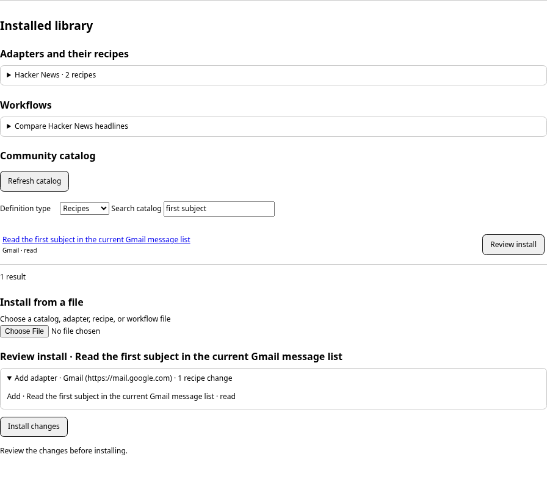
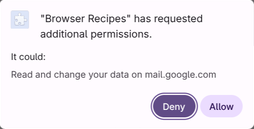
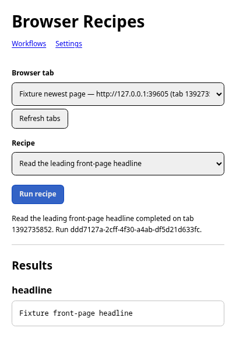

# Run your first browser recipe

Read the first subject in Gmail from the Browser Recipes side panel. The Gmail tab stays in the background, and the message stays unopened. You can also try the public Hacker News recipe without signing into a site.

[Run an installed recipe](#run-a-recipe) · [Copy Outlook events to Google Calendar](calendar-sync.md) · [Ask an agent to write a recipe](#ask-an-agent-to-write-a-recipe)

## Install the extension once

You need Git, Node.js 22.13 or later, npm, and a Chromium-based desktop browser that allows unpacked extensions. Once the extension and catalog are installed, running recipes from the browser takes no terminal, native host, or ChatGPT account. Chrome remote debugging can stay disabled.

Open a terminal in a directory where you can keep both projects. These commands use a POSIX shell (on Windows, use Git Bash).

```sh
git clone https://github.com/open-horizon-labs/browser-recipes
git clone https://github.com/open-horizon-labs/browser-recipes-catalog
cd browser-recipes
npm ci
npm run build
node ../browser-recipes-catalog/scripts/pack.mjs > ../browser-recipes-catalog.json
```

The build creates the extension in `dist`. The last command combines the catalog’s adapters, recipes and workflows into the file you’ll import.

1. In the browser profile where you use Gmail, open `chrome://extensions`.
2. Turn on **Developer mode**, choose **Load unpacked**, and select the **dist** folder inside **browser-recipes**. You should see a **Browser Recipes** extension card.
3. Keep the checkout where it is. Pin **Browser Recipes** in the browser’s Extensions menu so you can open the runner from the toolbar.

## Load the catalog and grant one site

1. Open **Browser Recipes** from the toolbar and select **Settings** in the runner.
2. Under **Installed adapters and workflows**, choose **Choose File**, select `browser-recipes-catalog.json` from the directory containing the two checkouts, then click **Save catalog**. Look for **Catalog saved.** Saving replaces your local catalog. If you already have private recipes, keep a copy before saving.



3. Under **Site access**, find **Gmail** and click **Grant access**. If you’re using the public example, choose **Hacker News** instead. Check the domain in the browser prompt, then click **Allow**. The button for that site changes to **Revoke access**.



Leave **Developer tools** off. You can leave the **Run recipes from the terminal** off, too.

## Run a recipe

1. Open a Gmail inbox with at least one message in this profile. For the public example, open [Hacker News](https://news.ycombinator.com/) instead.
2. Switch to another tab. Open **Browser Recipes** from the toolbar and click **Refresh tabs**. Under **Browser tab**, choose your Gmail or Hacker News tab by title and ID.
3. Choose the Gmail recipe that reads the first visible subject, or the Hacker News recipe that reads the leading headline. Click **Run recipe**.
4. Under **Results**, compare the subject or headline with what the target tab shows. You can use the same panel for another run. A recipe that needs text or a file will show the input before you run it.



To see what else you can run, open the app README in the [catalog](https://github.com/open-horizon-labs/browser-recipes-catalog/tree/main/adapters). For a task that uses two apps, follow [Copy Outlook events to Google Calendar](calendar-sync.md).

## Use a desktop chat or script

Claude or ChatGPT Desktop can walk you through the steps above while you use the panel. To let an agent run recipes itself, give it a terminal on the Linux desktop where the browser is open. An ordinary chat has no built-in Browser Recipes connector. For an installed workflow with an agent step, open **Workflows** and use **Sign in with ChatGPT**. The same connection powers the Guide. [Set up the connection](chatgpt-agent.md)

For terminal access, install Python 3.9 or later and open `chrome://extensions`. Copy the 32-character Browser Recipes ID. From the runtime checkout, run **one** of these commands with your ID:

| Browser | Register the local CLI |
| --- | --- |
| Google Chrome | `./bridge/browser-recipes install YOUR_EXTENSION_ID` |
| Chromium | `./bridge/browser-recipes install YOUR_EXTENSION_ID --browser chromium` |
| BrowserOS neo using the browser-claw data directory | `./bridge/browser-recipes install YOUR_EXTENSION_ID --browser browseros-neo` |

In Browser Recipes settings, check **Allow programs on this computer to run recipes**. Run these from the runtime checkout. In the last command, replace `123` with the Gmail tab ID from `tabs`.

```sh
./bridge/browser-recipes catalog
./bridge/browser-recipes tabs
./bridge/browser-recipes run '{"tabId":123,"adapterId":"gmail","recipeId":"first-visible-subject","inputs":{}}'
```

The result includes a `runId` and `outputs.subject`. You can compare the result locally and keep your mail out of the chat.


## Ask an agent to write a recipe

Start with the task you want to repeat. Give Claude or ChatGPT the starting page, what you normally do there, and the result you want back. For example:

> I want a Browser Recipes recipe for Hacker News. Starting from its home page, open Ask HN and return the first story title. Keep my foreground tab selected. Use the catalog’s browser-recipes-author skill. If you can access my two local checkouts and terminal, build and test the recipe there. Otherwise walk me through one local step at a time. Tell me which steps you actually tested.

Give the agent the [catalog authoring skill](https://github.com/open-horizon-labs/browser-recipes-catalog/blob/main/.agents/skills/browser-recipes-author/SKILL.md). If the chat can’t open the link, attach the file from your catalog checkout along with the references it calls for. A desktop chat can draft JSON from observations you provide. A live test needs access to the terminal and browser profile you connected above.

1. **Choose a test tab and scope.** Open the app at the agreed starting page. For a new app, the agent first adds an adapter for the exact site origin. Repeat the catalog pack command above and save the file in Settings, then grant that site access. Agree on any change the recipe may make before running a draft.
2. **Discover the flow.** In extension settings, enable **Developer tools**. Open **Workflows → Developer tools → Inspect tab**, or use `tabs` and `dev.inspect` through the CLI. For a draft based on your own actions, choose **Start recording**, perform the task in the selected document, then **Stop recording and load draft**. The draft uses placeholders for field values. If you’re running commands for the chat, share only the relevant controls. Inspection results can include private page text.
3. **Save and test the draft.** The agent puts shared targets in `adapters/<app>/adapter.json`, gives each recipe its own JSON file under `recipes/`, and documents the use case in the app README. Repack and save any new targets before using `dev.test`. Drafts execute real actions. For uploads or downloads, use a test attachment first. [Authoring instructions for writes and attachments](https://github.com/open-horizon-labs/browser-recipes-catalog/blob/main/.agents/skills/browser-recipes-author/references/writes-and-attachments.md)
4. **Prove it works as installed.** Pack and save the final catalog again. Turn off **Developer tools**, bring a different tab to the front, and use the ordinary `run` command. Ask for the command you can reuse, the run ID, and what the agent compared with the page. If you ran the command yourself, you can confirm the output locally. For a write, check what the app actually saved.

## If something goes wrong

| What you see | What to do |
| --- | --- |
| My tab is missing in the runner | Open it in the profile where you installed the extension, grant its exact site under **Settings**, and click **Refresh tabs**. |
| The CLI cannot connect | Check that the extension is enabled in the intended profile. Register the ID for that browser again. Toggle **Allow programs on this computer to run recipes** off and on, then try `catalog`. |
| The adapter is missing from `catalog` | Check for **Catalog saved.** Under **Site access**, a granted site shows **Revoke access**. |
| `tabs` returns an empty list | Open the app in the profile with the extension. Check that the page’s domain matches the origin you granted. Run `tabs` again. |
| A recipe fails on a step | Open **Failure details for recipe author** in the runner and copy the report. Give the agent the recipe ID, catalog revision (`git -C ../browser-recipes-catalog rev-parse HEAD` for a clean checkout), and returned error. Include the run ID, failed step, operation, target, and completed steps when present. For recent failure records, enable **Developer tools** and run `./bridge/browser-recipes dev.failures`. Check the app before retrying a write. |

To disconnect, uncheck **Allow programs on this computer to run recipes**. While it is on, other programs running as your Linux user can issue commands. Use **Revoke access** to withdraw permission for an individual site. [CLI reference](../bridge/README.md) · [Recipe format](recipes.md)
