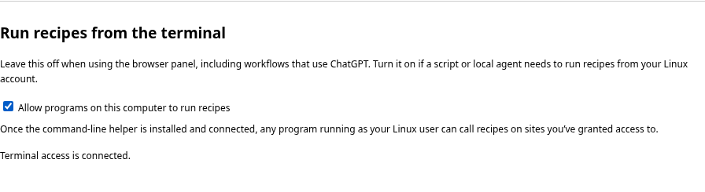

# Preview Outlook meetings for your Google calendar

See which meetings on your Outlook work calendar are missing from Google Calendar. The workflow compares a week in two signed-in tabs and shows the blocks you could copy. You can stop at that list or approve an import. If you want to review an expense report instead, select the Concur draft review workflow from the same catalog.

## Install the extension once

You need Git, Node.js 22.13 or later, npm, and a Chromium-based desktop browser that allows unpacked extensions. The calendar comparison includes a model step. To send it from the extension, set up the ChatGPT helper and sign in with ChatGPT. You can also take the reviewed prompt to your desktop chat and paste the reply back. [ChatGPT setup](chatgpt-agent.md) Chrome remote debugging can stay disabled.

Open a terminal in a directory where you can keep the extension. These commands use a POSIX shell (on Windows, use Git Bash).

```sh
git clone https://github.com/open-horizon-labs/browser-recipes
cd browser-recipes
npm ci
npm run build
```

The build creates the extension in `dist`.

1. In the browser profile where you use Outlook and Google Calendar, open `chrome://extensions`.
2. Turn on **Developer mode**, choose **Load unpacked**, and select the **dist** folder inside **browser-recipes**. You should see a **Browser Recipes** extension card.
3. Keep the checkout where it is. Pin **Browser Recipes** in the browser’s Extensions menu so you can open the runner from the toolbar.

After installing a read recipe and granting its site, open **Browser Recipes → Quick run** and click the recipe name to see its result. Quick run uses the default inputs. To enter a date range or other inputs, open **Settings → Installed library**, expand the adapter, and choose **Options** beside the recipe.

## Install the workflow and connect your calendars

1. Open **Browser Recipes** from the toolbar. Choose **Browse workflows**, then **Install** beside **Copy Outlook events to Google Calendar**. In an existing installation, use **Settings → Browse community catalog**.
2. The extension installs the workflow with its adapters and recipes. Follow **Set up Copy Outlook events to Google Calendar**.
3. Grant access to the Outlook host you actually use and to Google Calendar. Open both calendars in this browser profile and choose Week view in each. Choose the source and destination tabs by title. The list updates as tabs change.

## Preview the missing meetings

1. Choose **Start workflow**. In Runs, enter the first and last day to compare. Both tabs navigate to that range. Confirm their time zones when prompted.
2. Choose **Review what goes to ChatGPT** and check the data to share. Use **Send to ChatGPT** or **Prepare prompt for manual chat**. Review the reply and choose **Use reviewed reply**.
3. Inspect the proposed blocks. If Outlook shows meetings at 9 and 11 and Google already has the 9 o’clock block, only the 11 o’clock block should be offered. Stop here to preview, or select the blocks to carry forward. Titles default to **Busy**. The workflow asks you to approve the write before importing.


To finish the copy, confirm your selection, choose whether to include event titles, and enter the destination calendar name. Review the destination and approve the import. Check the Google Calendar receipt before running the workflow again. For the step-by-step controls and custom filters, see [Copy Outlook events to Google Calendar](calendar-sync.md).

## Filter recipe results or change inputs

Sign in under **Workflows → ChatGPT connection**. In the Recipes panel, open **Filter or change inputs with ChatGPT** before running a recipe, or **Filter or change outputs with ChatGPT** after it finishes. Describe which list entries to remove or which field values to change. Review the request, send it, then accept the proposed values if they match your instructions. You can save separate default instructions for inputs and outputs. Each send and acceptance is still explicit.

In Workflows, enable **Review inputs and results with ChatGPT** to pause between recipes. You can pass the original output along unchanged. The editor sends text and structured fields and omits attachment bytes. Workflow steps intended for document analysis have their own attachment selection.

## Use a desktop chat or script

Claude or ChatGPT Desktop can walk you through the steps above while you use the panel. To let an agent run recipes itself, give it a terminal on the Linux desktop where the browser is open. An ordinary chat has no built-in Browser Recipes connector. For an installed workflow with an agent step, open **Workflows** and use **Sign in with ChatGPT**. The same connection powers the Guide. [Set up the connection](chatgpt-agent.md)

For terminal access, install Python 3.9 or later and open `chrome://extensions`. Copy the 32-character Browser Recipes ID. From the runtime checkout, run **one** of these commands with your ID:

| Browser | Register the local CLI |
| --- | --- |
| Google Chrome | `./bridge/browser-recipes install YOUR_EXTENSION_ID` |
| Chromium | `./bridge/browser-recipes install YOUR_EXTENSION_ID --browser chromium` |
| BrowserOS neo using the browser-claw data directory | `./bridge/browser-recipes install YOUR_EXTENSION_ID --browser browseros-neo` |

In Browser Recipes settings, check **Allow programs on this computer to run recipes**. Run these from the runtime checkout. Use your Outlook account label in place of `217castle.com`. [Set up an account label](../bridge/README.md#run-by-account-label) Use `outlook-office` as the adapter ID if your tab uses `outlook.office.com`.

```sh
./bridge/browser-recipes catalog
./bridge/browser-recipes accounts.list
./bridge/browser-recipes run --adapter outlook --account 217castle.com --recipe read-calendar-week
```

The result includes a `runId` and the visible week’s events in `outputs.events`. To read specific dates, pass both bounds, for example `--inputs '{"first-day":"2026-11-08","last-day":"2026-11-14"}'`. Both dates are inclusive.



## Ask an agent to write a recipe

Start with the task you want to repeat. Give Claude or ChatGPT the starting page, what you normally do there, and the result you want back. For example:

> I want a Browser Recipes recipe for Outlook that lists the subjects and dates of the messages visible in my receipts folder. Keep my foreground tab selected. Use the catalog’s browser-recipes-author skill. If you can access my two local checkouts and terminal, build and test the recipe there. Otherwise walk me through one local step at a time. Tell me which steps you actually tested.

Give the agent the [catalog authoring skill](https://github.com/open-horizon-labs/browser-recipes-catalog/blob/main/.agents/skills/browser-recipes-author/SKILL.md). If the chat can’t open the link, attach the file from your catalog checkout along with the references it calls for. A desktop chat can draft JSON from observations you provide. A live test needs access to the terminal and browser profile you connected above.

1. **Choose a test tab and scope.** Open the app at the agreed starting page. For a new app, the agent first adds an adapter for the exact site origin. Import the adapter file in **Settings → Install from a file**, then grant that site access. Agree on any change the recipe may make before running a draft.
2. **Discover the flow.** In extension settings, enable **Developer tools**. Open **Workflows → Developer tools → Inspect tab**, or use `tabs` and `dev.inspect` through the CLI. For a draft based on your own actions, choose **Start recording**, perform the task in the selected document, then **Stop recording and load draft**. The draft uses placeholders for field values. If you’re running commands for the chat, share only the relevant controls. Inspection results can include private page text.
3. **Save and test the draft.** The agent puts shared targets in `adapters/<app>/adapter.json`, gives each recipe its own JSON file under `recipes/`, and documents the use case in the app README. Install any updated adapter targets before using `dev.test`. Drafts execute real actions. For uploads or downloads, use a test attachment first. [Authoring instructions for writes and attachments](https://github.com/open-horizon-labs/browser-recipes-catalog/blob/main/.agents/skills/browser-recipes-author/references/writes-and-attachments.md)
4. **Prove it works as installed.** Install the final recipe file under its adapter in **Installed library**. Turn off **Developer tools**, bring a different tab to the front, and use the ordinary `run` command. Ask for the command you can reuse, the run ID, and what the agent compared with the page. If you ran the command yourself, you can confirm the output locally. For a write, check what the app actually saved.

## If something goes wrong

| What you see | What to do |
| --- | --- |
| My tab is missing in the runner | Open it in the profile where you installed the extension, grant its exact site under **Settings**. |
| The CLI cannot connect | Check that the extension is enabled in the intended profile. Register the ID for that browser again. Toggle **Allow programs on this computer to run recipes** off and on, then try `catalog`. |
| The adapter is missing from `catalog` | Check for **Changes installed.** Under **Site access**, a granted site shows **Revoke access**. |
| `tabs` returns an empty list | Open the app in the profile with the extension. Check that the page’s domain matches the origin you granted. Run `tabs` again. |
| A recipe fails on a step | Open **Failure details** in the runner and copy the report. Give the agent the recipe ID, catalog revision (`git -C ../browser-recipes-catalog rev-parse HEAD` for a clean checkout), and returned error. Include the run ID, failed step, operation, target, and completed steps when present. For recent failure records, enable **Developer tools** and run `./bridge/browser-recipes dev.failures`. Check the app before retrying a write. |

To disconnect, uncheck **Allow programs on this computer to run recipes**. While it is on, other programs running as your Linux user can issue commands. Use **Revoke access** to withdraw permission for an individual site. [CLI reference](../bridge/README.md) · [Recipe format](recipes.md)
